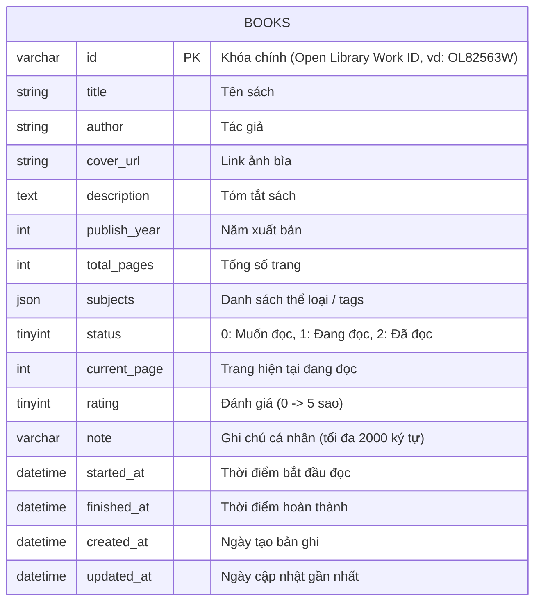

# Mini Reading Tracker - Backend API

> RESTful API Gateway trung gian kết nối Open Library và quản lý Tủ sách cá nhân lưu trữ trên MySQL.

---

## 1. Giới thiệu ngắn

**Mini Reading Tracker Backend** đóng vai trò là API Gateway và tầng dịch vụ trung tâm:

- **Tích hợp Open Library:** Proxy và điều phối tìm kiếm sách, tự động làm giàu thông tin trạng thái sách trong tủ (`inLibrary: boolean`).
- **Quản lý Tủ sách cá nhân:** Lưu trữ và quản lý dữ liệu bền vững trên MySQL (các trạng thái _Muốn đọc_, _Đang đọc_, _Đã đọc_).
- **Theo dõi tiến độ đọc:** Kiểm tra tính hợp lệ trang đọc, tự động cập nhật mốc thời gian bắt đầu (`started_at`), thời điểm kết thúc (`finished_at`) và tự động hoàn thành sách khi trang hiện tại bằng tổng số trang.
- **Tài liệu trực quan:** Tích hợp sẵn Swagger UI theo chuẩn OpenAPI 3.0 tại endpoint `/api-docs`.

---

## 2. Công nghệ sử dụng

- **Ngôn ngữ:** TypeScript
- **Runtime:** Node.js
- **Web Framework:** Express.js
- **Cơ sở dữ liệu & Driver:** MySQL / `mysql2`
- **HTTP Client:** Axios
- **Data Validation:** Zod
- **API Documentation:** Swagger UI
- **Security & Logging:** Helmet, CORS, Morgan, Winston

---

## 3. Hướng dẫn chạy Local

### Yêu cầu tiên quyết

- Node.js >= 20.x và npm

### Các bước cài đặt & khởi chạy

#### Bước 1: Chuẩn bị Cơ sở dữ liệu MySQL

Dự án đã sử dụng **Aiven for MySQL** trên đám mây (đã khởi tạo sẵn schema và bảng `books`), bạn không cần cài đặt hoặc khởi tạo database ở máy local. Chỉ cần đảm bảo điền đúng thông tin kết nối Aiven vào file `.env` ở Bước 2.
_(Nếu muốn xem cấu trúc DDL để tham khảo, có thể xem tại file `sql/schema.sql`)._

#### Bước 2: Cấu hình biến môi trường

Tạo file `.env` tại thư mục gốc của backend và paste toàn bộ nội dung cấu hình biến môi trường đã được gửi đính kèm trong Gmail (bao gồm thông tin kết nối Aiven MySQL và cấu hình server).

````bash


#### Bước 3: Cài đặt thư viện & Chạy ứng dụng
```bash
# Cài đặt dependencies
npm install

# Chạy môi trường Development (hỗ trợ hot-reload qua tsx)
npm run dev

# Hoặc biên dịch & chạy Production
npm run build
npm run start
````

Sau khi khởi chạy thành công:

- **Base API URL:** `http://localhost:8000/api/v1`
- **Swagger Documentation:** `http://localhost:8000/api-docs`

---

## 4. Mô tả kiến trúc & Sơ đồ Database

### 4.1. Kiến trúc hệ thống (3-Tier Layered Architecture)

Hệ thống được tổ chức theo mô hình phân tầng chặt chẽ:

- **Router & Middleware:** Tiếp nhận request, áp dụng Helmet, CORS, validate dữ liệu đầu vào qua Zod schema (`requestValidator`).
- **Controller:** Nhận request đã được validate, gọi Service xử lý và trả về chuẩn `ApiResponse`.
- **Service:** Xử lý toàn bộ logic nghiệp vụ (gọi Open Library API, chuẩn hóa dữ liệu, tính toán tiến độ đọc, điều kiện chuyển trạng thái).
- **Repository:** Tầng DAO truy vấn MySQL qua connection pool với Prepared Statements.

[](https://mermaid.live/edit#pako:eNqFk29vokAQxr_KZF9pggpW5OTFJS3a6yUSrZg2KZjLKnOVFFhuWVo99bvfLP5pfXX7ameW5_cMM7s7thIxMpe9Sl6sIZJRDrS8NMFcNcJ7KXKFeQwduJ3-PKUXTWi1vu8f5vMpzPBPhaXa6-NwtCkkliXcFgV0eJF03q2FJp6pZbU82tzx1ZumekLi-VAv7UFo8J9DP4njFD84AV14wDRDZYA3mQUGvIgYnniaxFwJufiq959ruTcfhx4VLkWaoiT9Uoi3z4QBabKUXG4_U1cUkteY4MkLA5TvyQpPjFN0AZziKzWp6vbco1qtYVJgDuPj13uYjH9pqKDk-P-ExwrlljrvV4orhOHdHmaj6SQ8mc-wEGVCLdhe1NTT8_ZodRlUAD9Gc11A2PhaEgGDuW5782pQ2qaWTiUWNIIYAl1CRsMv91RI2PC3weMYhlzxJS-xuWAG3aAkZq6SFRosQ5lxHbKdJkZMrUkdMZe2hKs2rZVIhYxYlB9IWvD8RYjsrJaiel0z9zdPS4qqggaNw4TT3ckuWUn_itITVa6Ye9N1aghzd2zD3K7ttE1n8M0cdK3eYGBbBtsyt9Vv962e3b_pmXaXDqyBfTDY39rXaptd03Ic0zH7pu30-gbDWPfWP76O-pEc_gExrwIz)

### 4.2. Sơ đồ Database (ERD)

Dữ liệu tủ sách được quản lý qua bảng `books`:



## 5. Danh sách API (Swagger Documentation)

Tài liệu API tương tác trực tiếp được tích hợp tại:
👉 **Swagger UI:** `http://localhost:8000/api-docs` (hoặc `/api-docs.json`)

### Tóm tắt Endpoints:

| Phương thức | Endpoint              | Mô tả                          | Tham số chính                                                                                                                 |
| :---------- | :-------------------- | :----------------------------- | :---------------------------------------------------------------------------------------------------------------------------- |
| `GET`       | `/api/v1/books`       | Tìm kiếm sách qua Open Library | Query: `keyword` (bắt buộc), `page` (default 1), `limit` (default 20, max 50). Trả về danh sách sách kèm cờ `inLibrary`.      |
| `GET`       | `/api/v1/library`     | Lấy toàn bộ sách trong tủ      | Không cần tham số. Lấy tất cả sách kèm tiến độ, đánh giá, ghi chú và thể loại.                                                |
| `POST`      | `/api/v1/library`     | Thêm sách vào tủ cá nhân       | Body: `{ id: string, status?: number }`. Tự động fetch metadata từ Open Library, lưu MySQL. Trả về `409` nếu sách đã tồn tại. |
| `PATCH`     | `/api/v1/library`     | Cập nhật tiến độ / Đánh giá    | Body: `{ id: string, currentPage?: number, rating?: number, note?: string }`.                                                 |
| `DELETE`    | `/api/v1/library/:id` | Xóa sách khỏi tủ cá nhân       | Params: `id`.                                                                                                                 |

### Chuẩn hóa Response & Error

- **Thành công khi tìm kiếm sách (`/api/v1/books` - có phân trang):**

  ```json
  {
    "data": [ ... ],
    "meta": {
      "page": 1,
      "limit": 20,
      "total": 50,
      "totalPages": 3
    }
  }
  ```

- **Thất bại (400 / 404 / 409 / 500):**
  ```json
  {
    "error": {
      "code": "VALIDATION_ERROR",
      "message": "Dữ liệu không hợp lệ",
      "details": {
        "currentPage": "Trang hiện tại không được lớn hơn tổng số trang"
      }
    }
  }
  ```

---

## 6. Mô tả cách đã Deploy

Hệ thống Backend được triển khai công khai trên nền tảng Cloud với giao thức **HTTPS bắt buộc** thông qua sự kết hợp giữa **Render** và **Aiven**:

- **Backend Hosting:** [Render](https://render.com) (Web Service)
- **Database:** [Aiven for MySQL](https://aiven.io) (Managed Cloud MySQL với kết nối SSL)

### Các bước đã thực hiện:

#### 1. Cơ sở dữ liệu (Aiven for MySQL):

- Khởi tạo Service MySQL trên Aiven (phiên bản 8.0).
- Chạy file `sql/schema.sql` để tạo cấu trúc bảng `books`.
- Lấy thông tin kết nối an toàn: `Host`, `Port`, `User`, `Password`, `Database Name`.

#### 2. Triển khai Web Service trên Render:

- Tạo một **Web Service** mới trên Render và liên kết với Git repository `reading-tracker-be`.
- Cấu hình Build & Start command:
  - **Runtime:** `Node`
  - **Build Command:** `npm install && npm run build`
  - **Start Command:** `npm run start`
- Thiết lập các biến môi trường (**Environment Variables**) trên Render:
  - `PORT`: `8000` (hoặc cổng do Render cấp)
  - `NODE_ENV`: `production`
  - `DB_HOST`: Host của Aiven MySQL
  - `DB_PORT`: Port của Aiven MySQL
  - `DB_USER`: Username database
  - `DB_PASSWORD`: Password database
  - `DB_NAME`: `defaultdb`
  - `DB_CONNECTION_LIMIT`: `10`
  - `CORS_ORIGIN`: Domain công khai của Frontend (ví dụ: `https://your-frontend.vercel.app` hoặc `*`)
- Render tự động build TypeScript qua `tsc`, chạy server và cấp chứng chỉ SSL/TLS miễn phí (**HTTPS**) tại đường dẫn: `https://<ten-dich-vu>.onrender.com`.

---

## 7. Các giả định, hạn chế và hướng cải thiện

### 7.1. Giả định (Assumptions)

- **Mô hình Single-user:** Hệ thống phục vụ quản lý tủ sách cá nhân đơn lẻ, chưa cần cơ chế phân quyền tài khoản (JWT/Auth).
- **Khóa định danh Open Library:** Tác phẩm được định danh duy nhất thông qua mã `workId` (ví dụ `OL82563W`).
- **Dữ liệu linh động:** Các thông tin như số trang (`total_pages`) hoặc mô tả sách từ Open Library có thể thiếu; Backend hỗ trợ fallback hợp lý (trích xuất median pages từ Search API, placeholder cho cover/description).

### 7.2. Hạn chế (Limitations)

- **Chưa có Authentication (Xác thực):** Chưa hỗ trợ đa người dùng (Multi-user); hiện tại toàn bộ thao tác trong tủ sách dùng chung một không gian lưu trữ duy nhất.
- Thời gian phản hồi tìm kiếm phụ thuộc vào tốc độ và độ ổn định của API Open Library công cộng.
- Chưa có bộ nhớ đệm (Cache) ở tầng Backend đối với các từ khóa tìm kiếm lặp lại.

### 7.3. Hướng cải thiện nếu có thêm thời gian

1. **Xác thực & Đa người dùng (Multi-tenant):**
   - Bổ sung bảng `users` và liên kết quan hệ 1-Nhiều với bảng `books`.
   - Hỗ trợ đăng nhập qua Google OAuth2 / JWT.
2. **Mở rộng tính năng:**
   - Thống kê biểu đồ trang sách đọc theo tuần/tháng/năm.
   - Thiết lập mục tiêu đọc sách hàng năm (Reading Challenge).
   - Thêm nhật ký từng buổi đọc (Reading Sessions: ngày đọc, số trang đọc trong buổi, thời gian đọc).
